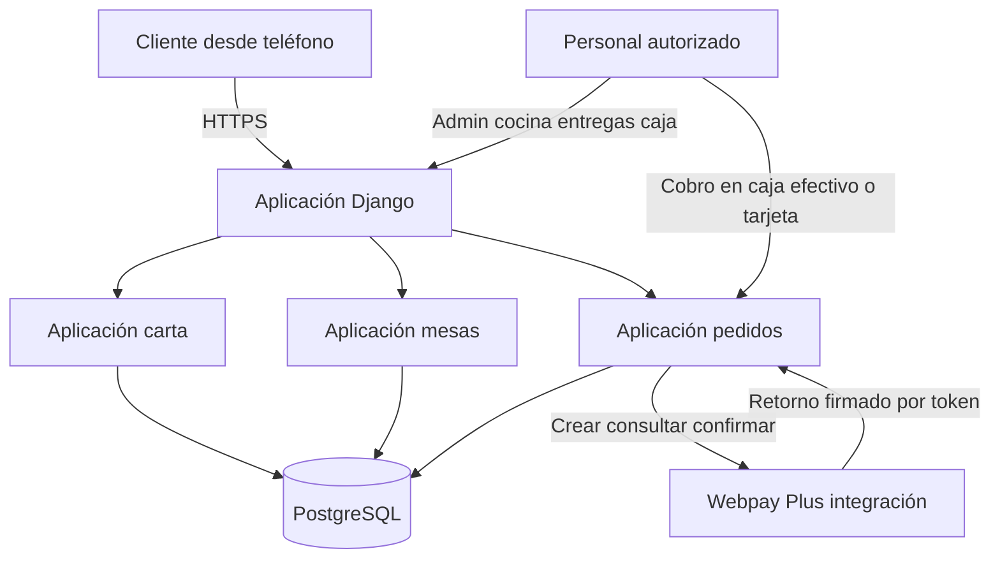

# Arquitectura de Kippu

Kippu usa una arquitectura web monolítica modular: **seis dominios en tres aplicaciones Django** (`carta`, `mesas` y `pedidos`). Django concentra las reglas de negocio, el acceso a datos y la generación de HTML. PostgreSQL conserva la información persistente. El navegador mantiene el carrito en la sesión y usa HTMX para actualizar fragmentos sin recargar toda la página. Webpay Plus es el único servicio externo del flujo de pago; el cliente también puede pagar en la caja del local.

## Dominios y aplicaciones

| Dominio | Aplicación Django | Responsabilidad |
|---|---|---|
| Carta | `carta` | Categorías, productos, imágenes, opciones y presentación de la carta |
| Mesas | `mesas` | Locales, mesas, código QR y habilitación de pedidos |
| Pedidos | `pedidos` | Carrito, pedidos, cuentas y estados |
| Pagos | `pedidos` | Webpay Plus, pago en caja, comprobante y cierre de cuenta |
| Cocina | `pedidos` | Cola de pedidos pagados, preparación y entregas |
| Administración | Admin de Django y paneles del personal | Locales, mesas, productos y caja |

| Componente de soporte | Responsabilidad |
|---|---|
| `config` | Configuración, rutas globales, idioma, zona horaria, archivos estáticos y ajustes de HTTPS |
| PostgreSQL | Persistencia relacional, restricciones y bloqueos transaccionales |
| Webpay Plus | Inicio, consulta y confirmación de pagos en integración |

## Comunicación

El navegador solicita la carta de una mesa mediante su UUID. Las operaciones del carrito usan POST y protección CSRF. HTMX recibe fragmentos HTML generados por Django. Al pagar, el servidor calcula nuevamente el monto desde la base de datos.

- **Pago con Webpay:** el servidor crea un intento y redirige a Webpay. El retorno público se valida contra el token almacenado y el servidor consulta al proveedor antes de registrar el pago.
- **Pago en caja:** el pedido queda "por pagar en caja" y no pasa a cocina. Cuando el personal cobra en efectivo o con tarjeta desde el panel de caja, el servidor registra el pago con el usuario que cobró. Si no se paga en 30 minutos, el pedido se cancela solo.

En ambos casos, solo un pago confirmado lleva el pedido a cocina. La publicación en la web se describe en `05_DESPLIEGUE.md`.
