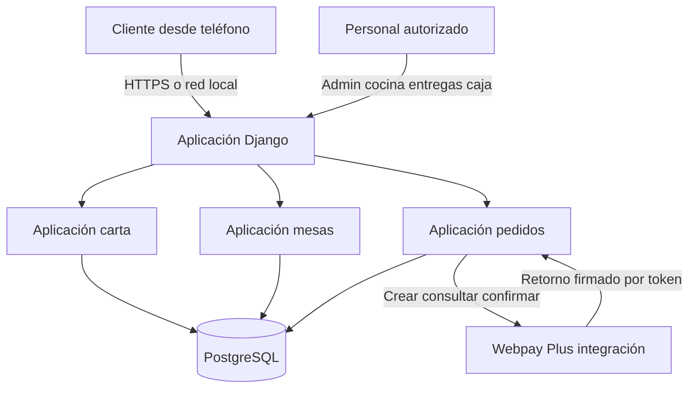

# Arquitectura de Kippu

Kippu usa una arquitectura web monolítica modular. Django concentra las reglas de negocio, el acceso a datos y la generación de HTML. PostgreSQL conserva la información persistente. El navegador mantiene el carrito en la sesión y usa HTMX para actualizar fragmentos sin recargar toda la página. Webpay Plus es el único servicio externo del flujo principal.

## Componentes

| Componente | Responsabilidad |
|---|---|
| `carta` | Categorías, productos, imágenes, opciones y presentación de la carta |
| `mesas` | Locales, mesas, código QR y habilitación de pedidos |
| `pedidos` | Carrito, pedidos, cuentas, pagos, Webpay, cocina, entregas y caja |
| `config` | Configuración, rutas globales, idioma, zona horaria y archivos estáticos |
| PostgreSQL | Persistencia relacional, restricciones y bloqueos transaccionales |
| Webpay Plus | Inicio, consulta y confirmación de pagos en integración |

## Comunicación

El navegador solicita la carta de una mesa mediante su UUID. Las operaciones del carrito usan POST y protección CSRF. HTMX recibe fragmentos HTML generados por Django. Al pagar, el servidor calcula nuevamente el monto desde la base de datos, crea un intento y redirige a Webpay. El retorno público se valida contra el token almacenado y el servidor consulta al proveedor antes de registrar el pago. Solo entonces el pedido pasa a cocina.
