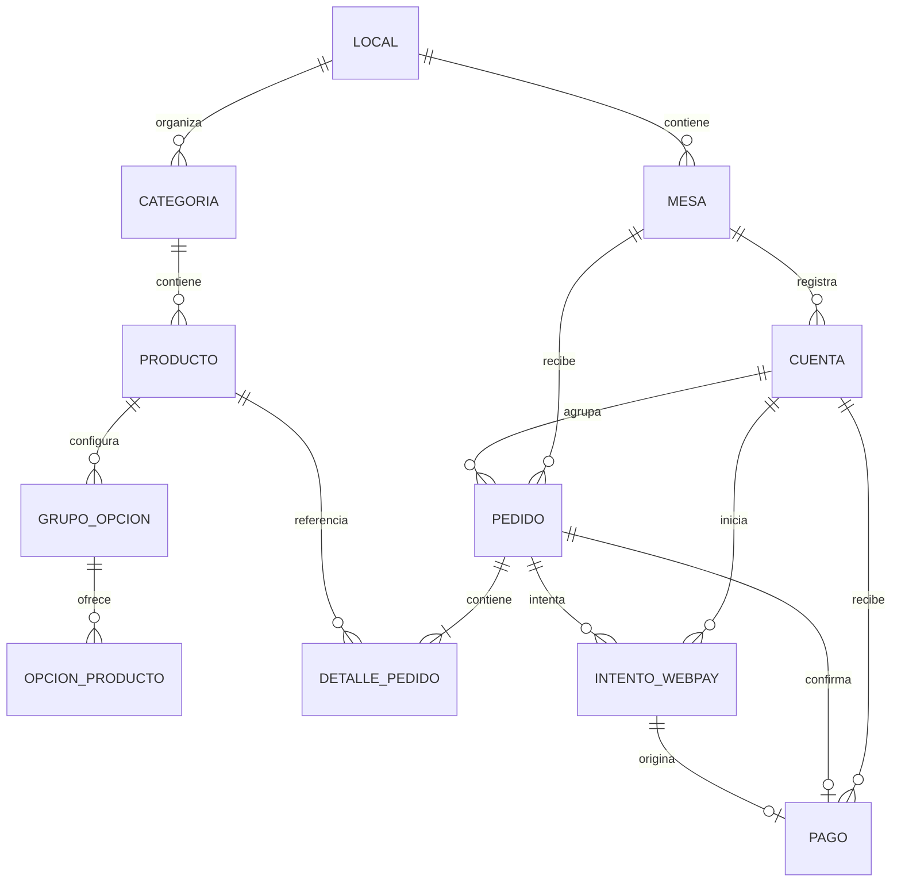

# Modelo de datos de Kippu

El modelo relacional separa catálogo, operación del restaurante y pago. Las claves foráneas protegidas conservan el historial de productos, pedidos y pagos.

## Reglas principales

- El número de mesa es único dentro de cada local.
- Una mesa tiene como máximo una cuenta abierta.
- Un pedido pagado tiene como máximo un pago asociado.
- Un pedido o cuenta no puede mantener más de un intento Webpay activo según las restricciones condicionales.
- Los precios, opciones, propina y condición de mayoría de edad quedan registrados como una fotografía del pedido.
- Los montos deben ser positivos y la propina no puede ser negativa.

## Diccionario resumido

| Entidad | Datos principales |
|---|---|
| Local | Nombre, slug, estado y recepción de pedidos |
| Mesa | Local, número, estado y UUID usado por el QR |
| Producto | Categoría, nombre, descripción, precio, disponibilidad, imagen y restricción de edad |
| Pedido | Mesa, cuenta, nombre, estado, cliente, propina y confirmación de edad |
| DetallePedido | Producto, nombre, precio, cantidad, opciones y restricción de edad |
| Cuenta | Mesa, estado, apertura y cierre |
| IntentoWebpay | Orden, sesión, token, monto, estado y datos de autorización |
| Pago | Cuenta, pedido, intento, monto, método y fecha |
