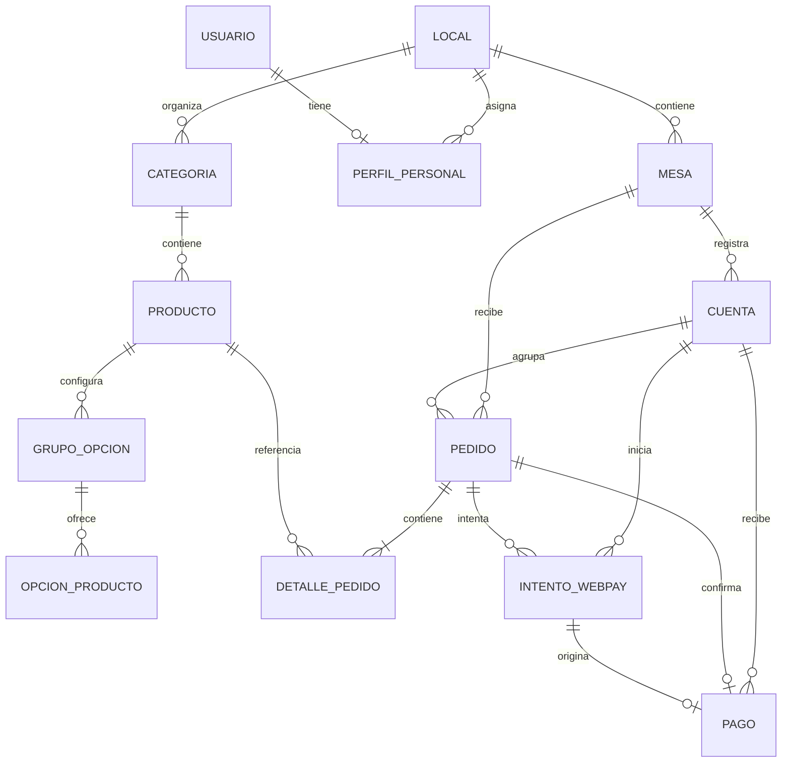

# Modelo de datos de Kippu

El modelo relacional separa catálogo, operación del restaurante y pago. Las claves foráneas protegidas conservan el historial de productos, pedidos y pagos.

## Reglas principales

- El número de mesa es único dentro de cada local.
- Una mesa tiene como máximo una cuenta abierta.
- Cada usuario del personal está ligado a un solo local (`PerfilPersonal`); el panel muestra y modifica solo los datos de ese local.
- Un pedido pagado tiene como máximo un pago asociado.
- Un pedido no puede mantener más de un intento Webpay activo (la restricción es **por pedido**). La restricción por cuenta solo se aplica a los intentos sin pedido, que pagan una cuenta anterior.
- Un pedido que se paga en caja queda en estado "por pagar en caja" y no tiene intento Webpay. El pago lo registra el personal con método efectivo, débito o crédito, y queda guardado quién lo registró.
- Los precios, opciones, propina y condición de mayoría de edad quedan registrados como una fotografía del pedido.
- Los montos deben ser positivos y la propina no puede ser negativa.

## Diccionario resumido

| Entidad | Datos principales |
|---|---|
| Local | Nombre, slug, estado y recepción de pedidos |
| Mesa | Local, número, estado y UUID usado por el QR |
| PerfilPersonal | Usuario del personal y el local donde trabaja |
| Producto | Categoría, nombre, descripción, precio, disponibilidad, imagen y restricción de edad |
| Pedido | Mesa, cuenta, nombre, estado, cliente, propina y confirmación de edad |
| DetallePedido | Producto, nombre, precio, cantidad, opciones y restricción de edad |
| Cuenta | Mesa, estado, apertura y cierre |
| IntentoWebpay | Orden, sesión, token, monto, estado y datos de autorización |
| Pago | Cuenta, pedido, intento (solo Webpay), monto, método (Webpay, efectivo, débito o crédito), usuario que lo registró (pago en caja) y fecha |

## Migraciones

El modelo llega hasta la migración `0013` de `pedidos` (`0012_alter_pedido_estado` agrega el estado "por pagar en caja" y `0013_alter_pago_metodo` deja como métodos de pago Webpay, efectivo, débito y crédito). `carta` llega hasta `0005` y `mesas` hasta `0004` (`0004_perfil_personal`, que liga a cada usuario del personal con su local).
