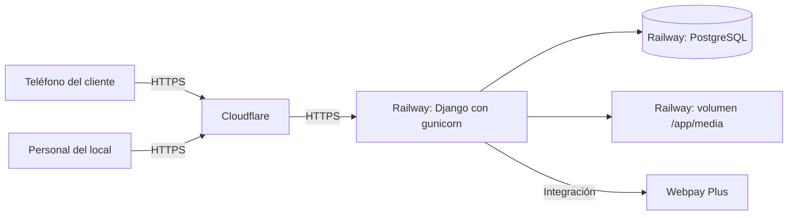

# Despliegue de Kippu

Kippu está publicado en **https://kippurestaurant.com**. Se optó por un **despliegue en la nube en lugar de contenedores**: Docker quedó fuera por decisión del profesor (10-11-2026).



## Componentes

| Componente | Función |
|---|---|
| Cloudflare | Dominio `kippurestaurant.com`, DNS, certificado HTTPS hacia el cliente y protección delante de la aplicación |
| Railway, servicio de la aplicación | Ejecuta Django con `gunicorn` desde el repositorio de código |
| Railway, PostgreSQL | Base de datos del sitio publicado, distinta de las bases locales de desarrollo |
| Railway, volumen | Guarda las fotos de `/media`; no se pierden al volver a desplegar |
| WhiteNoise | Sirve el CSS, el JavaScript y las fuentes con `DEBUG` apagado |

## Configuración

La configuración vive en variables de entorno del servicio, nunca en el repositorio. Este documento solo nombra las variables.

| Variable | Uso en el sitio publicado |
|---|---|
| `DB_NAME`, `DB_USER`, `DB_PASSWORD`, `DB_HOST`, `DB_PORT` | Referencias a las variables del servicio PostgreSQL de Railway |
| `DJANGO_SECRET_KEY` | Clave nueva, distinta de la usada en desarrollo |
| `DJANGO_DEBUG` | Apagado |
| `DJANGO_HTTPS` | Encendido: redirección a HTTPS, cookies seguras, HSTS y encabezado del proxy |
| `DJANGO_SERVIR_MEDIA` | Encendido: Django sirve las fotos del volumen |
| `PUBLIC_BASE_URL` | Dirección pública con la que se arman los QR y el origen de confianza de CSRF |
| `DJANGO_ALLOWED_HOSTS` | Dominio del sitio |

En cada despliegue, Railway ejecuta las migraciones antes de iniciar la nueva versión (`python manage.py migrate --noinput`) y luego inicia la aplicación:

```text
python manage.py collectstatic --noinput && gunicorn config.wsgi --bind 0.0.0.0:$PORT
```

En Cloudflare, el dominio apunta a Railway con el proxy activo, y la conexión entre Cloudflare y Railway también usa HTTPS.

## Pagos

Webpay Plus sigue en el **ambiente de integración**, con el código de comercio y la llave públicos del SDK de Transbank. La URL de retorno se arma con el dominio publicado, por lo que el cliente vuelve a `https://kippurestaurant.com` después de pagar. Ninguna tarjeta real funciona en este ambiente.

## Puesta en marcha de los datos

La base publicada parte vacía. Después del primer despliegue, dentro del servicio, se crea el superusuario (`python manage.py createsuperuser`) y se carga La Casa Causa (`python manage.py cargar_casa_causa`). El comando de carga solo completa lo que falta, por lo que se puede repetir para sumar fotos nuevas. Los QR de cada mesa se descargan nuevamente desde `/admin/` → Mesas, porque ahora apuntan al dominio.

## Verificación

El 05-11-2026 se comprobó desde fuera de la red local que `http://kippurestaurant.com` redirige a HTTPS, que la carta, el CSS y el ingreso al administrador responden, y que el sitio entrega el encabezado HSTS. La revisión de seguridad de la configuración (`manage.py check --deploy`) y de las dependencias (`pip-audit`) está en `06_PRUEBAS.md`.

## Alcance

- Railway cobra por uso (plan Hobby: US$5 al mes, con US$5 de uso incluido). Si el crédito de la cuenta se agota, el servicio se detiene.
- HSTS está en una hora a propósito mientras el dominio se estabiliza.
- No hay respaldo automático programado de la base de datos ni monitoreo aparte del panel de Railway.
- Las credenciales de Transbank son las de integración; un local real necesitaría las suyas.
