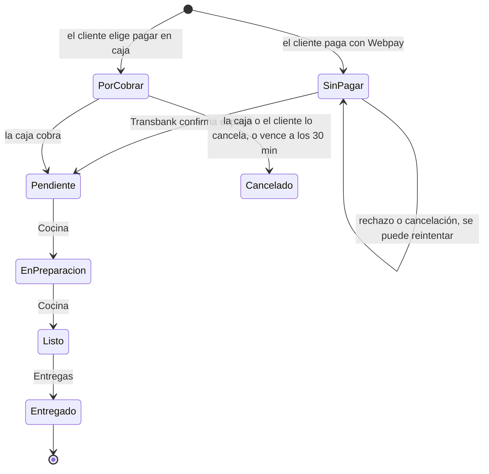
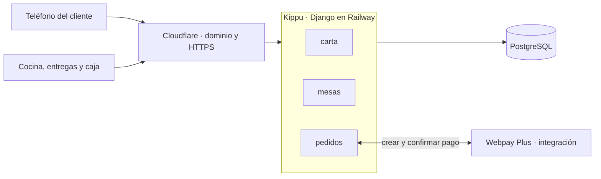

# Kippu

Sistema de autopedido y pago por QR para restaurantes.

Proyecto Capstone (APT122) de **Gian Cabana** y **Sebastián Delgado**.
Sitio publicado: https://kippurestaurant.com

## Índice

1. [Descripción](#descripción)
2. [Funcionalidades](#funcionalidades)
3. [Flujo de un pedido](#flujo-de-un-pedido)
4. [Tecnologías](#tecnologías)
5. [Arquitectura](#arquitectura)
6. [Estructura del repositorio](#estructura-del-repositorio)
7. [Ejecutar localmente (Windows y PowerShell)](#ejecutar-localmente-windows-y-powershell)
8. [Pagar en el ambiente de integración](#pagar-en-el-ambiente-de-integración)
9. [En la web](#en-la-web)
10. [Seguridad](#seguridad)
11. [Pruebas](#pruebas)
12. [Alcance y pendientes](#alcance-y-pendientes)
13. [Integrantes, roles y metodología](#integrantes-roles-y-metodología)

## Descripción

Kippu es una aplicación web responsive. El cliente escanea el QR de su mesa, arma su pedido y lo paga
desde su teléfono, con Webpay Plus (ambiente de integración) o en caja. El pedido entra a cocina solo
cuando el pago está confirmado. Está pensado para restaurantes independientes con servicio de mesa y
carta acotada.

Caso de estudio simulado: **La Casa Causa**, restaurante peruano de 16 mesas.

El personal usa tres pantallas: Cocina, Entregas y Caja. Locales, mesas, carta, personal y códigos QR
se administran desde `/admin/`.

## Funcionalidades

### Cliente (desde el teléfono, sin cuenta ni descarga)

- **Carta por mesa:** el QR abre la carta del local de esa mesa, con categorías, fotos y detalle de
  cada producto.
- **Opciones de producto:** tamaño, acompañamiento y agregados, obligatorios u opcionales, de selección
  simple o múltiple y con recargo.
- **Carrito con HTMX:** se agrega y se quita sin recargar la página. El carrito pertenece a la sesión de
  cada teléfono, así que dos personas en la misma mesa piden por separado.
- **Productos +18:** van marcados en la carta, exigen confirmar la mayoría de edad antes de pagar y
  llegan a cocina y entregas con un aviso para pedir identificación.
- **Propina opcional:** se sugiere un 10 % redondeado hacia arriba a pesos enteros. El cliente puede
  aceptarla o no.
- **Nombre opcional:** sirve para que el personal identifique el pedido al entregarlo.
- **Dos formas de pago:**
  - **Webpay Plus** (integración): el pedido pasa a cocina solo después de confirmar el pago con
    Transbank.
  - **Pagar en caja:** el pedido queda "por pagar en caja" y pasa a cocina cuando el cajero lo cobra.
    Se vence solo a los 30 minutos si nadie lo cobra.
- **Reintento de pago:** si Webpay rechaza o se cancela, el carrito se conserva y se puede reintentar
  con una transacción nueva.
- **Comprobante de demostración:** con el desglose de productos, propina y total. No es una boleta del
  SII.
- **Mis pedidos:** muestra el estado de cada pedido de la visita actual (pagado, en preparación, listo
  o entregado) y se actualiza solo.

### Personal

- **Panel separado por local:** cada usuario del personal está asignado a un local y solo ve y
  modifica los pedidos, cobros y mesas de ese local.
- **Cocina:** recibe los pedidos pagados, los pasa a "en preparación" y a "listo", y muestra cuánto
  tiempo lleva cada uno. Se actualiza cada 15 segundos.
- **Entregas:** muestra los pedidos listos para llevar a la mesa y los marca como entregados.
- **Caja:**
  - Cobra los pedidos "por pagar en caja" en efectivo, débito o crédito, o los cancela.
  - Muestra los pagos Webpay por verificar.
  - Cierra mesas.
  - Abre y cierra la recepción de pedidos por QR del local. Lo ya pagado sigue su curso.
  - Las listas se actualizan con HTMX.
- **Recuento de caja por día:** el total cobrado de un día, separado por método de pago.
- **Cierre automático:** una cuenta sin actividad durante una hora se cierra sola, siempre que no
  tenga pedidos pagados sin entregar.

### Administración (`/admin/`)

- Locales, mesas, categorías, productos con foto (JPG, PNG o WebP de hasta 2 MB) y grupos de opciones.
- **Descarga del QR de cada mesa** desde Mesas, con la dirección de `PUBLIC_BASE_URL`.
- **Asignación del personal a su local** desde Usuarios: abrir el usuario, marcar "Es staff" y elegir
  el local en la sección "Local del personal".
- Admin con la marca de Kippu.

## Flujo de un pedido



Pagar no cierra la mesa. La mesa se cierra desde Caja, o sola tras una hora sin actividad, y solo si
todos sus pedidos pagados ya se entregaron.

## Tecnologías

| Capa | Tecnología |
|---|---|
| Lenguaje | Python 3.13 (probado también en 3.14) |
| Framework | Django 5.2.17 |
| Base de datos | PostgreSQL 17 o 18 (driver `psycopg` 3.3.5) |
| Interactividad | HTMX 2.0.11 y Alpine.js 3.14.9, servidos desde `static/js/vendor/` |
| Pagos | Webpay Plus con `transbank-sdk` 6.1.0, solo en ambiente de integración |
| Otros | `qrcode` 8.2, Pillow 13.0.0, `python-dotenv` 1.2.3, WhiteNoise 6.12.0 (archivos estáticos) y gunicorn 26.2.0 (servidor en la web) |
| Publicación | Railway (aplicación y PostgreSQL) y Cloudflare (dominio, HTTPS y protección) |
| Control de versiones | Git y GitHub, con una rama por cambio y Pull Request hacia `main` |

## Arquitectura

Monolito modular en Django: un solo proyecto y una sola base de datos, con los dominios separados en
aplicaciones y archivos. El único servicio externo es Webpay Plus.

| Dominio | Dónde vive |
|---|---|
| Carta | app `carta` |
| Mesas, locales y personal por local | app `mesas`, `pedidos/personal.py` |
| Pedidos y carrito | `pedidos/views.py`, `pedidos/carrito.py` |
| Pagos (Webpay y en caja) | `pedidos/pagos.py`, `vistas_webpay.py`, `webpay.py`, `presencial.py`, `vistas_presencial.py` |
| Cocina y entregas | `pedidos/views.py` |
| Caja, recuento y cierre de mesa | `pedidos/views.py`, `pedidos/cierre.py` |



### Modelo de datos principal

| Modelo | Qué guarda |
|---|---|
| `Local` | Restaurante. Indica si está activo y si recibe pedidos por QR. |
| `Mesa` | Número, local y un código UUID que va en el QR. |
| `PerfilPersonal` | Une a un usuario del personal con su local. |
| `Categoria`, `Producto` | Carta de cada local, con precio en pesos, foto y marca +18. |
| `GrupoOpcion`, `OpcionProducto` | Opciones de cada producto y su recargo. |
| `Cuenta` | Visita a una mesa, abierta o cerrada. |
| `Pedido`, `DetallePedido` | Pedido con su estado, propina y nombre. Cada línea guarda una copia del nombre, el precio y las opciones del momento de la compra. |
| `IntentoWebpay` | Cada transacción con Transbank: token, monto, estado y respuesta. |
| `Pago` | Pago confirmado de un pedido: Webpay, efectivo, débito o crédito. |

## Estructura del repositorio

```
kippu/
├── config/          Configuración de Django (settings, urls, wsgi) y sus pruebas
├── carta/           Carta: categorías, productos, opciones, imágenes
│   ├── management/commands/cargar_casa_causa.py   Datos de prueba
│   └── semillas/imagenes/la-casa-causa/          Fotos de los productos
├── mesas/           Locales, mesas, QR y personal por local
├── pedidos/         Carrito, pedidos, pagos, cocina, entregas, caja y cierre
├── templates/       Plantilla base y login del admin
├── static/          CSS, fuentes, HTMX, Alpine.js e ícono
├── .env.example     Variables de entorno de ejemplo
└── requirements.txt Dependencias con versión fija
```

Las pruebas de cada aplicación están en su carpeta `tests/`.

## Ejecutar localmente (Windows y PowerShell)

### 1. Requisitos

- **Python 3.13**, instalado con la casilla "Add python.exe to PATH".
- **Git.**
- **PostgreSQL 17 o 18.**

### 2. Crear la base de datos

Abrir `psql` con el usuario `postgres`, cambiando `18` por la versión instalada:

```powershell
& "C:\Program Files\PostgreSQL\18\bin\psql.exe" -U postgres
```

Luego crear el usuario y la base:

```sql
CREATE USER kippu WITH PASSWORD 'kippu123' CREATEDB;
CREATE DATABASE kippu OWNER kippu;
\q
```

`CREATEDB` es necesario porque las pruebas crean una base temporal.

### 3. Descargar el proyecto e instalar dependencias

```powershell
cd $HOME\Desktop
git clone https://github.com/GianCabana/kippu.git
cd kippu
py -3.13 -m venv .venv
.\.venv\Scripts\python.exe -m pip install -r requirements.txt
Copy-Item .env.example .env
```

### 4. Completar `.env`

| Variable | Valor |
|---|---|
| `DB_NAME`, `DB_USER`, `DB_PASSWORD`, `DB_HOST`, `DB_PORT` | Conexión a PostgreSQL |
| `DJANGO_SECRET_KEY` | Una clave larga y aleatoria |
| `PUBLIC_BASE_URL` | Dirección con la que se arma el QR, por ejemplo `http://127.0.0.1:8000` |
| `DJANGO_ALLOWED_HOSTS` | Hosts aceptados, separados por comas (vacío: `127.0.0.1,localhost`) |
| `DJANGO_DEBUG` | `True` en el computador de desarrollo (sirve `/media` y muestra los errores); vacío o `False` en la web |
| `DJANGO_HTTPS` | `True` solo en la web con HTTPS (redirige a HTTPS, cookies seguras y HSTS); `False` en local |
| `DJANGO_SERVIR_MEDIA` | `True` solo en la web, para que Django sirva las fotos de `/media` con `DEBUG` apagado |

Para generar la clave secreta:

```powershell
.\.venv\Scripts\python.exe -c "import secrets; print(secrets.token_urlsafe(50))"
```

Webpay no necesita credenciales: usa el código de comercio y la clave públicos de integración del SDK.

### 5. Crear las tablas, el administrador y los datos de prueba

```powershell
.\.venv\Scripts\python.exe manage.py migrate
.\.venv\Scripts\python.exe manage.py createsuperuser
.\.venv\Scripts\python.exe manage.py cargar_casa_causa
```

`cargar_casa_causa` crea La Casa Causa (16 mesas, carta con fotos y descripciones) y un segundo local
de prueba. Se puede correr más de una vez sin duplicar datos y no reemplaza lo que se cambió en el
admin.

**Importante:** el panel del personal exige que el usuario tenga un local asignado, incluso si es
superusuario. Entrar a `/admin/` → Usuarios → tu usuario → "Local del personal" y elegir La Casa Causa.

### 6. Iniciar

```powershell
.\.venv\Scripts\python.exe manage.py runserver
```

| Pantalla | Dirección |
|---|---|
| Administración y QR | `http://127.0.0.1:8000/admin/` |
| Cocina | `http://127.0.0.1:8000/pedidos/cocina/` |
| Entregas | `http://127.0.0.1:8000/pedidos/entregas/` |
| Caja | `http://127.0.0.1:8000/pedidos/caja/` |
| Carta de una mesa | La dirección del QR, `/mesa/<código>/` |

### Desde un teléfono en la misma red

En el teléfono, `127.0.0.1` es el propio teléfono. Para entrar desde él:

1. Averiguar la IP del computador con `ipconfig` (Dirección IPv4, por ejemplo `192.168.2.110`).
2. En `.env`, poner `PUBLIC_BASE_URL=http://<IP>:8000` y agregar la IP a `DJANGO_ALLOWED_HOSTS`.
3. Iniciar con `.\.venv\Scripts\python.exe manage.py runserver 0.0.0.0:8000`.
4. Permitir Python en el Firewall de Windows para redes privadas. La red Wi-Fi debe tener el perfil
   "Privada".
5. Volver a descargar los QR desde el admin, porque guardan la dirección del `.env`.

### Agregar fotos de productos al repositorio

Las fotos subidas desde el admin quedan en `media/`, que Git ignora. Para que formen parte del
proyecto, se guardan en `carta/semillas/imagenes/<slug-del-local>/<slug-del-producto>.jpg` (también
`.webp`, `.jpeg` o `.png`). `cargar_casa_causa` las copia a los productos que no tienen foto.

## Pagar en el ambiente de integración

Webpay está en ambiente de integración: **no se cobra dinero real**. Solo se deben usar las tarjetas
de prueba de Transbank, nunca una tarjeta real.

| Tipo | Número | CVV | Vencimiento | Resultado |
|---|---|---|---|---|
| Crédito VISA | `4051 8856 0044 6623` | `123` | Cualquier fecha futura | Aprobada |
| Crédito Mastercard | `5186 0595 5959 0568` | `123` | Cualquier fecha futura | Rechazada |
| Débito Redcompra | `4051 8842 3993 7763` | — | — | Aprobada |
| Débito Redcompra | `5186 0085 4123 3829` | — | — | Rechazada |

En la pantalla de autenticación del banco: RUT `11.111.111-1` y clave `123`.

Referencia: [documentación de Transbank Developers](https://www.transbankdevelopers.cl/documentacion/como_empezar#ambiente-de-integracion).

## En la web

Kippu se publica en https://kippurestaurant.com. Railway ejecuta la aplicación y PostgreSQL, y
Cloudflare maneja el dominio, el HTTPS y la protección delante de Railway.

- **Variables en Railway:** las de la tabla de `.env`, con:
  - `DJANGO_DEBUG=False`, `DJANGO_HTTPS=True` y `DJANGO_SERVIR_MEDIA=True`.
  - `PUBLIC_BASE_URL=https://kippurestaurant.com`.
  - `DJANGO_ALLOWED_HOSTS=kippurestaurant.com,www.kippurestaurant.com`.
  - Una `DJANGO_SECRET_KEY` nueva y las `DB_*` del servicio de PostgreSQL de Railway.
- **Antes de cada despliegue:** `python manage.py migrate --noinput`.
- **Arranque:** `python manage.py collectstatic --noinput && gunicorn config.wsgi --bind 0.0.0.0:$PORT`.
- **Fotos:** `/media` vive en un volumen de Railway montado en `/app/media`, que no se borra al
  desplegar.
- **Cloudflare:** registro DNS con proxy hacia Railway y SSL en modo *Full (strict)*.
- **Webpay** sigue en integración. La URL de retorno se arma con el dominio.

## Seguridad

- **Precios en el servidor:** el total se calcula con los precios de la base de datos, nunca con lo
  que envía el navegador. Una propina o una confirmación +18 alteradas se rechazan.
- **Pagos confirmados con Transbank:** el pedido solo pasa a cocina si Transbank confirma el pago y
  coinciden el monto, la orden de compra y la sesión. Ningún dato de tarjeta pasa por Kippu.
- **Sin cobros duplicados:** los bloqueos de base de datos (`SELECT FOR UPDATE`) impiden que un doble
  clic o dos retornos simultáneos registren dos pagos.
- **Protección CSRF** en todos los formularios. La única excepción es el retorno de Webpay, que no
  confía en lo que llega del navegador y consulta el resultado directamente a Transbank.
- **Comprobante privado:** se abre con un enlace firmado que vence en una hora.
- **Privacidad entre clientes:** cada teléfono ve solo sus pedidos de la visita actual.
- **Personal por local:** cada usuario del personal ve y modifica solo los datos de su local. El local
  sale del usuario autenticado, nunca de la dirección.
- **Imágenes validadas:** solo JPG, PNG o WebP reales de hasta 2 MB.
- **Configuración de producción:**
  - `DEBUG` apagado por defecto.
  - HTTPS obligatorio, cookies seguras y HSTS cuando `DJANGO_HTTPS=True`.
  - La configuración de producción pasa `manage.py check --deploy`.

## Pruebas

El proyecto tiene **339 pruebas automáticas**, en la carpeta `tests/` de cada aplicación:

| Aplicación | Pruebas | Qué cubren |
|---|---|---|
| `pedidos` | 270 | Carrito, Webpay, reintentos, pago en caja, propina, +18, opciones, cocina, entregas, caja, recuento, cierre de mesa, personal por local y privacidad de Mis pedidos |
| `carta` | 46 | Carta, detalle de producto, imágenes, diseño y carga de datos de prueba |
| `config` | 18 | Configuración de producción, archivos estáticos, `/media` y hosts |
| `mesas` | 5 | Locales y mesas |

```powershell
.\.venv\Scripts\python.exe manage.py check
.\.venv\Scripts\python.exe manage.py makemigrations --check --dry-run
.\.venv\Scripts\python.exe manage.py test
```

Las pruebas de concurrencia necesitan PostgreSQL, porque usan `SELECT FOR UPDATE`.

Para ver solo las de seguridad, con el nombre de cada prueba:

```powershell
.\.venv\Scripts\python.exe manage.py test pedidos.tests.test_csrf_webpay pedidos.tests.test_login_personal pedidos.tests.test_locales_personal pedidos.tests.test_webpay_demo carta.tests.test_imagenes config.tests.test_config -v 2
```

## Alcance y pendientes

**Fuera de alcance:** inventario y stock, reportes de ventas más allá del recuento diario, reembolsos,
boleta electrónica y Webpay en producción.

**Pendientes identificados:**

- Folio de pedidos correlativo por local (del 1 al 100).
- Historial de cambios de estado de cada pedido, con la hora de cada paso.
- Límite de pedidos por mesa por minuto.

## Integrantes, roles y metodología

- **Eje A, dominio y datos (Sebastián Delgado):** carta, mesas y pedidos, modelo de datos, panel de
  administración y documentación.
- **Eje B, transacción e integración (Gian Cabana):** pagos y cocina, integración con Transbank,
  seguridad aplicada y despliegue.

**Metodología:** Scrum adaptado a un equipo de dos, con desarrollo incremental por módulos en sprints
de dos semanas, backlog, revisión y retrospectiva. Sin reuniones diarias ni roles de Scrum Master y
Product Owner. Cada cambio se desarrolla en su propia rama y se une a `main` con un Pull Request.
